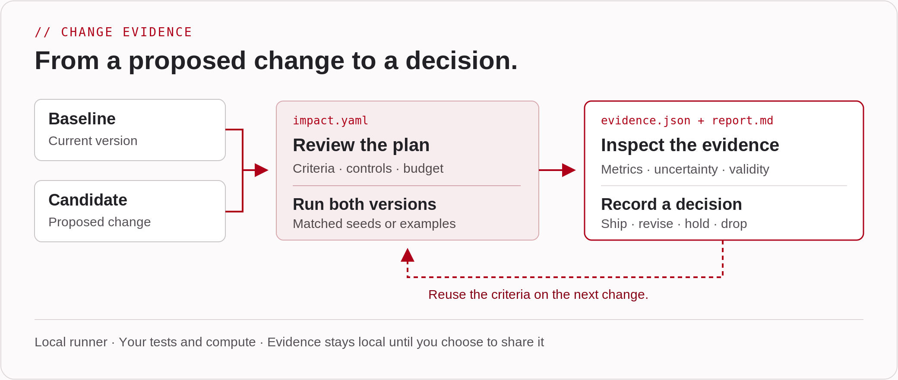
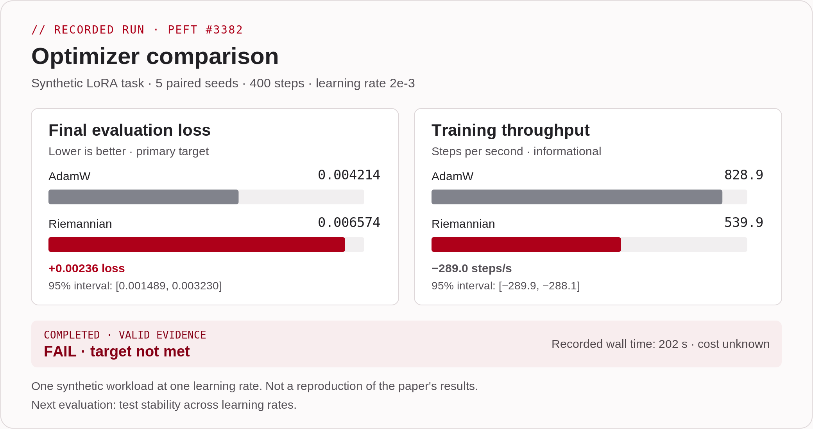

# Validate

**Know before you merge.**

A new model, retrieval strategy or agent harness can improve one part of your AI system while making another worse.

Validate is an open-source evaluation harness for measuring those tradeoffs. Compare a proposed change against your baseline using your own tests, data and compute. Define what you want to improve, set the requirements your application needs to meet, and capture the evidence behind your decision.

Run locally without a Remyx account. Reuse your evaluation criteria across changes and build a record of what works for your system.

We're developing the Change Evidence Spec alongside Validate so that developers, coding agents and evaluation tools can work with a common format for these results.

[Quickstart](#quickstart) · [See a completed run](#example-peft-optimizer-comparison) · [Read the draft specification](spec/v0.1/SPEC.md) · [Managed Validate](https://remyx.ai/validate)

> Developer alpha (v0.1). Runs locally without a Remyx account. The evidence format is a draft; interfaces may change. Start with code and evaluation scripts you trust.



## Quickstart

**Run your first comparison.**

Try a small retrieval comparison on your CPU. You need Git, Python 3.10 or newer, and a POSIX shell (macOS or Linux; CI covers Linux on Python 3.10 and 3.12 and macOS on 3.12). The demo needs no model weights, GPU or API key. Installation requires network access to download dependencies; the installed demo can run offline. The package is not on PyPI yet, so install from source:

```bash
git clone https://github.com/remyxai/validate.git
cd validate
python3 -m venv .venv
source .venv/bin/activate
python -m pip install .
remyx-validate demo --dir validate-demo
```

Your tests. Your data. Your compute. No account required.

The demo compares two versions of a small support-article retriever on 240 generated queries. A deeper reranking pass retrieves more of the right articles, but exceeds the declared latency limit. The verdict is `FAIL` (guardrail veto). Retrieval accuracy comes from the actual retrieval task; latency and cost in this demo are simulated from operation counts.

```bash
cd validate-demo
remyx-validate report
remyx-validate verify
remyx-validate record --decision revise --reason "Latency over the declared limit"
```

The report and machine-readable evidence are saved under `.validate/runs/`. Try `remyx-validate demo --all --dir validate-fixtures` from the repository root to see examples of all five verdicts.

## Evaluate a change in your repository

Start with a pull request or two Git refs. Use an evaluation you already trust: a Python script, a benchmark, or a command that produces metrics. The declaration tells Validate how to run that evaluation and what the result needs to establish.

```bash
mkdir my-eval && cd my-eval
remyx-validate init --pr https://github.com/huggingface/peft/pull/3382
```

`init` pins the PR's merge base and head and writes an `impact.yaml` template. For a local repository, use `init --repo /path/to/repo --baseline main --candidate feature-branch` instead. A pull-request scaffold is written with `execution.trust: review-required`, and `plan` will not accept it until you choose how to run the code. Review the code, setup commands and execution settings before running either version. Add your evaluation script under `harness/` (or use an existing command), and fill in the metric names, targets, guardrails and validity checks in `impact.yaml`.

Here is the criteria portion of a retrieval evaluation declaration (illustrative):

```yaml
criteria:
  - id: resolution
    metric: resolved
    role: target
    direction: higher
    min_improvement: 0.02
  - id: p95_latency
    metric: latency_ms
    role: guardrail
    direction: lower
    aggregate: p95
    max: 800
  - id: cost
    metric: cost_usd
    role: info
    direction: lower
```

For this example, resolution is a proportion, the required improvement is two percentage points, and p95 latency must stay at or below 800 ms. See the [declaration reference](spec/v0.1/SPEC.md) for the full format and the meaning of its uncertainty rules.

Run a command that reports metrics. For per-example metrics, keep the same example IDs across both versions so they can be paired. A harness can write `$VALIDATE_OUTPUT_DIR/results.json`:

```json
{
  "metrics": {"dataset_size": 240},
  "observations": [
    {"unit": "q001", "metrics": {"resolved": 1, "latency_ms": 412, "cost_usd": 0.0004}}
  ]
}
```

A final `METRICS_JSON={...}` line or a flat metric map is also supported. See the [worked PEFT example](examples/peft-riemannian/) for a complete harness and declaration.

### Review the plan, then run

```bash
remyx-validate validate
remyx-validate plan
```

Inspect the resolved commits, evaluation command, harness, criteria, resource budget and permissions. Copy the displayed plan digest into the next command in place of `YOUR_PLAN_DIGEST` after reviewing it.

```bash
remyx-validate approve YOUR_PLAN_DIGEST
remyx-validate run
remyx-validate report
remyx-validate verify
```

A change to the approved plan requires a new approval. The report includes the baseline and candidate measurements, uncertainty where supported by the sample, validity checks, execution details and the verdict. Run `remyx-validate status` for run history and `remyx-validate cancel` to stop a running evaluation.

### What you get

| Artifact | What it records |
| --- | --- |
| `report.md` | Results, tradeoffs, verdict and limitations for review |
| `evidence.json` | Structured comparison, criteria, identities and provenance |
| `manifest.json` and `declaration.json` | The approved plan and resolved evaluation declaration |
| `observations.jsonl` | The measurements used to compute the comparison |
| `checksums.json` | File digests for checking bundle consistency |
| `.validate/decisions.jsonl` | Your decision, reason and reference to the evidence |

`remyx-validate verify` checks the files, the identities that tie them together, and recomputes the comparison from the observations. A local bundle is self-reported evidence; consistency checks do not prove who ran the evaluation or that the workload measured honestly.

Keep a record of why you chose to ship, revise, hold or drop a change:

```bash
remyx-validate record --decision revise --reason "Improve retrieval within the latency limit"
remyx-validate decisions
```

To prepare a bundle for sharing:

```bash
remyx-validate export --public --output evidence.tar.gz
remyx-validate verify evidence.tar.gz
```

Public export keeps an allowlist of files, removes logs by default and attempts to redact common sensitive strings and local paths. If redaction would alter the declaration, the plan or the observations, the export is refused. Review every exported file before sharing. No upload is performed. Keep credentials out of declarations and results; use only the explicitly approved environment variables required by your evaluation.

## How to read a result

The execution status tells you whether the run finished. Validity checks tell you whether the comparison can support the claim. The verdict applies the criteria you declared. The decision is yours to record separately.

| Verdict | Meaning |
| --- | --- |
| `PASS` | Targets met and guardrails clear under the declared rule |
| `WARN` | A criterion remains uncertain |
| `FAIL` | A target is not met or a guardrail is breached |
| `NO_SIGNAL` | The comparison cannot distinguish a useful signal (for example, the candidate behavior was never activated or a control drifted) |
| `INCOMPLETE` | Execution or required measurement failed, or integrity checks failed |

If the independent sampling unit is an example, results are paired by example ID. If it is a seed, results are paired by seed. With one paired unit there is no estimated interval. Cost and latency can be targets, guardrails or informational metrics. The offline result describes the chosen evaluation setup; measure the effect on live users separately.

## Example: PEFT optimizer comparison

We used Validate to evaluate [huggingface/peft#3382](https://github.com/huggingface/peft/pull/3382), a contribution that adds a Riemannian-preconditioned LoRA optimizer. We wanted to see whether the proposed optimizer would reach a lower evaluation loss than AdamW at the same step budget.

Both versions train a LoRA adapter on a synthetic teacher-student task. We held the data, initialization, learning rate (2e-3) and training steps (400) constant across five paired seeds on CPU. An activation witness checks that the candidate arm used the preconditioned optimizer.



| Measure | AdamW | Riemannian | Paired difference (95% interval) |
| --- | ---: | ---: | --- |
| Final evaluation loss | 0.004214 | 0.006574 | +0.00236 [0.001489, 0.003230] |
| Training throughput (steps/s) | 828.9 | 539.9 | -289.0 [-289.9, -288.1] |

The candidate ended with a higher loss on every seed in this recorded run. The target was not met. Throughput was also lower. This is a small synthetic benchmark at one learning rate, not a reproduction of the paper's main results. The next comparison we'd run is a learning-rate sweep to examine stability across learning rates.

[Read the evidence report](examples/peft-riemannian/sample-evidence/report.md) · [Inspect the harness and reproduce the comparison](examples/peft-riemannian/)

From the repository root, verify the recorded bundle without installing PyTorch or running the benchmark again:

```bash
remyx-validate verify examples/peft-riemannian/sample-evidence
```

Verification checks the recorded evidence; reproduction runs the evaluation again. The committed result is recorded on one machine and has not been independently reproduced. The reproduction guide requires `uv`, Python 3.12 and network access for the initial PEFT and CPU PyTorch setup.

## The Change Evidence Spec

A result is easier to build on when it keeps its context: what changed, what the team wanted to measure, how it was measured, what happened and what the team decided.

We're publishing a draft, versioned [Change Evidence Spec](spec/v0.1/SPEC.md) and JSON schemas for that record. The local runner is one producer. We want other evaluation tools and coding agents to be able to produce and consume the same evidence without depending on a Remyx account. The deployment/outcome schema is a draft; this release does not collect production outcomes or recommend subsequent changes.

| Object | What it keeps |
| --- | --- |
| Change | Baseline, candidate and hypothesis |
| Declaration | Evaluation question, criteria, method and validity checks |
| Execution | Resolved plan, run and attempt identities |
| Observation / comparison | Measurements, paired differences, uncertainty and verdict |
| Decision | What a person chose and why |
| Deployment / outcome | A future link to a deployed change and observed outcomes (draft) |

Review [the spec's open questions](spec/v0.1/SPEC.md#open-questions-for-review), open an issue with an evaluation format or use case we should support, or contribute a fixture that exercises the contract. See [CONTRIBUTING.md](CONTRIBUTING.md).

## Local execution and trust

Use the local subprocess backend only with code, setup commands and harnesses you trust. It runs with your user's file and network access. Docker support is experimental in this alpha; untrusted declarations get no network and no host variables by default. Container isolation is limited, setup can require network access, and the workload can influence its own measurements. Do not use this release as a security boundary for hostile PR code or on a machine containing sensitive credentials. Read the [threat model](docs/THREAT_MODEL.md) and [security reporting policy](SECURITY.md).

The tool does not send evidence to Remyx or collect telemetry. Git fetches, dependency installation, and any external model or data calls made by your evaluation are separate network activity. Reported-cost caps are checked against metrics emitted by the harness after attempts; they are not guaranteed spending limits. Set provider-side limits when making paid API calls.

## Where it fits

**Measure the impact of your next AI change.**

| Open source | Managed Validate |
| --- | --- |
| **Run your own evaluations.** Bring your evaluation scripts, define your criteria, run comparisons on your infrastructure and retain portable evidence. | **Automate your evaluations.** Validate prepares the evaluation for review, configures the environment, runs the comparison and returns evidence to your pull request. |
| Run locally without a Remyx account. | [Evaluate a PR](https://remyx.ai/validate). |

The [Change Evidence Spec](spec/v0.1/SPEC.md) is a proposed common format for recording evaluations and decisions. We're working toward interoperability between the standalone runner, managed Validate and other producers. The standalone and managed implementations are separate in this alpha. Shared-core parity and direct bundle import are planned, not available today.

[Outrider](https://github.com/remyxai/outrider) is available separately for finding and drafting promising changes.

## Contribute

Try the runner on a change you're already considering. Tell us what you measured, which tools you used, and what was missing from the evidence. You do not need to share your private data or results to report an issue.

- [Report a problem or suggest a spec change](https://github.com/remyxai/validate/issues)
- [Contribution guidelines](CONTRIBUTING.md)
- [Security policy](SECURITY.md)

## License

Apache 2.0. See [LICENSE](LICENSE).
